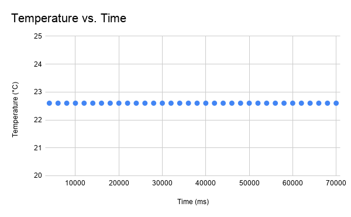
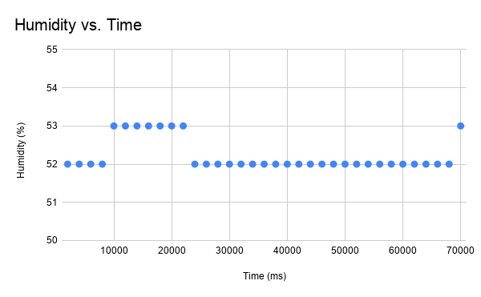

# Smart Environmental Monitoring System

An Arduino-based environmental monitoring system that measures temperature and humidity, detects high-temperature conditions, provides visual alerts, and automatically records sensor data for analysis using Python.

This project was developed to gain hands-on experience in embedded systems, sensor interfacing, circuit prototyping, hardware-software integration, and environmental data acquisition.

## Project Overview

The system uses an Arduino Uno R3 and a DHT11 sensor to monitor environmental temperature and relative humidity.

When the measured temperature reaches or exceeds 26°C, the Arduino automatically activates a red warning LED.

Sensor measurements are transmitted over USB serial communication in CSV format. A Python application receives the measurements and automatically saves them into timestamped CSV files for further analysis.

The project combines embedded C++ firmware, Python programming, electronic hardware, serial communication, and data visualization.

## Features

- Real-time temperature monitoring in degrees Celsius
- Relative humidity monitoring (%)
- Automatic high-temperature warning at 26°C
- Red LED visual alert
- Sensor error detection
- Non-blocking sensor measurement scheduling using `millis()`
- CSV-formatted serial output every 2 seconds
- Automatic CSV recording using Python and PySerial
- Timestamped CSV filenames for recording sessions
- Temperature and humidity data visualization
- GitHub version control and technical documentation

## Hardware Components

| Component | Purpose |
|---|---|
| Arduino Uno R3 | Main microcontroller |
| DHT11 Sensor Module | Temperature and humidity measurements |
| Red LED | High-temperature visual warning |
| 220 Ohm Resistor | Limits LED current |
| Breadboard | Circuit prototyping |
| Jumper Wires | Electrical connections |
| USB Cable | Power, programming, and serial communication |

## Hardware Connections

| Component | Arduino Connection |
|---|---|
| DHT11 Signal (S) | Digital Pin 2 |
| DHT11 VCC (+) | 5V |
| DHT11 GND (-) | GND |
| Red LED Anode (+) | Digital Pin 8 through 220 Ohm resistor |
| Red LED Cathode (-) | GND |

## Circuit Schematic

The system's electrical connections were designed and documented
using KiCad.

The schematic includes:
- Arduino Uno R3 microcontroller
- DHT11 temperature and humidity sensor
- Red warning LED with 220 Ohm current-limiting resistor
- Planned I2C LCD1602 display connections

The schematic passed KiCad Electrical Rules Checker (ERC)
with zero reported errors and warnings.

### Schematic Files

- [View Circuit Schematic (PDF)](hardware/Environmental_Monitor_Schematic.pdf)
- [Download Editable KiCad Schematic](hardware/Environmental_Monitor_Schematic.kicad_sch)
- [Download KiCad Project File](hardware/Environmental_Monitor_Schematic.kicad_pro)

**Note:** The I2C LCD connections are included in the schematic
but have not yet been physically assembled and tested. The
adapter pin order will be verified during hardware integration.


## Software and Libraries

### Arduino

- Arduino IDE
- Arduino C/C++
- Adafruit DHT Sensor Library
- Adafruit Unified Sensor Library

### Python

- Python 3
- PySerial 3.5
- Built-in Python `csv`, `datetime`, and `pathlib` modules

### Other Tools

- Google Sheets for data visualization
- GitHub for version control and documentation

## System Operation

1. The Arduino initializes the DHT11 sensor and serial communication.
2. Temperature and humidity are measured every 2 seconds.
3. The measured temperature is compared against a 26°C threshold.
4. If the threshold is reached, the warning LED turns ON.
5. Otherwise, the LED remains OFF.
6. Measurements and system status are transmitted in CSV format.
7. The Python logger can receive and automatically save the measurements.
8. The collected data can be analyzed using spreadsheet software.

### Warning Conditions

| Temperature | LED State | System Status |
|---|---|---|
| Below 26°C | OFF | NORMAL |
| 26°C or higher | ON | WARNING |
| Invalid sensor reading | ON | SENSOR_ERROR |

## Data Logging

The Arduino sends measurements through USB serial communication at 9600 baud.

The CSV output contains four fields:

- `time_ms`: Milliseconds since Arduino startup
- `temperature_c`: Temperature in degrees Celsius
- `humidity_pct`: Relative humidity percentage
- `status`: NORMAL, WARNING, or SENSOR_ERROR

### Example Serial Output

```text
time_ms,temperature_c,humidity_pct,status
2000,22.60,52.00,NORMAL
4000,22.60,52.00,NORMAL
6000,22.60,52.00,NORMAL
```

### Manual Data Collection

During initial development, measurements were copied from Arduino Serial Monitor and saved as a CSV file.

The initial dataset contains 35 measurements collected over approximately 70 seconds.

[View Sample Sensor Dataset](data/sample_readings.csv)

### Automatic Data Logging with Python

A Python-based serial logger was developed to automatically collect environmental measurements from the Arduino.

The program uses PySerial to read the Arduino's serial output and automatically write measurements into a CSV file.

Each recording session generates a unique timestamped filename, preventing previous recordings from being overwritten.

#### Requirements

- Python 3
- PySerial library
- Arduino Uno connected through USB
- Environmental monitoring firmware uploaded to Arduino

#### Install PySerial

On Windows, using Python 3.15:

```bash
py -3.15 -m pip install pyserial
```

Alternatively, with a correctly configured Python installation:

```bash
python -m pip install pyserial
```

#### Running the Python Logger

1. Connect the Arduino to the computer using USB.
2. Ensure the environmental monitoring firmware is uploaded.
3. Close Arduino IDE Serial Monitor and Serial Plotter.
4. Open `logger/serial_logger.py`.
5. Set the `PORT` variable to the Arduino's current COM port.
6. Open Command Prompt in the repository's root directory.
7. Run the Python logger:

```bash
py -3.15 logger/serial_logger.py
```

8. Observe incoming temperature and humidity measurements.
9. Press Ctrl+C to stop recording.

Example terminal output:

```text
Connected to Arduino!
Recording sensor measurements...
Press Ctrl+C to stop.
Saved: 2000,22.20,62.00,NORMAL
Saved: 4000,22.20,62.00,NORMAL
Saved: 6000,22.20,62.00,NORMAL
```

The logger creates CSV files in the same directory as `serial_logger.py`.

This allows measurements to be recorded automatically without manually copying data from Serial Monitor.

**Python Source Code:** [View Automatic Serial Logger](logger/serial_logger.py)

## Experimental Results

An initial 70-second recording was collected with 35 sensor measurements at approximately 2-second intervals.

### Temperature vs. Time



Temperature remained stable at approximately 22.6°C during the recorded test.

### Humidity vs. Time



Relative humidity varied between 52% and 53% during the recorded test.

### Observations

- Temperature remained stable throughout the initial recording.
- Humidity showed small variations of approximately 1 percentage point.
- The system remained in NORMAL status during the initial dataset.
- The warning LED was separately tested by raising the temperature measured by the DHT11 until the 26°C threshold was reached.
- The Python logger was successfully tested using real sensor measurements and automatically generated a CSV file.

## Testing and Verification

The following tests were successfully completed:

- Arduino initialization and serial heartbeat test
- DHT11 temperature measurement test
- DHT11 humidity measurement test
- Warning LED startup test
- Temperature threshold activation test
- Normal operating condition test
- CSV serial output verification
- Manual CSV data collection
- Temperature and humidity visualization
- Python serial connection test
- Automatic CSV file generation
- Python data logging with real sensor readings

## Repository Structure

```text
arduino-environmental-monitor/
├── README.md
├── firmware/
│   └── environmental_monitor/
│       └── environmental_monitor.ino
├── logger/
│   └── serial_logger.py
├── data/
│   └── sample_readings.csv
├── images/
│   ├── README.md
│   ├── temperature_vs_time.png
│   └── humidity_vs_time.png
└── hardware/
    ├── README.md
    ├── Environmental_Monitor_Schematic.pdf
    ├── Environmental_Monitor_Schematic.kicad_pro
    └── Environmental_Monitor_Schematic.kicad_sch
```

## How to Run

### Arduino Firmware

1. Assemble the circuit according to the hardware connections table.
2. Install the Adafruit DHT Sensor Library and its dependencies.
3. Open `firmware/environmental_monitor/environmental_monitor.ino` in Arduino IDE.
4. Select Arduino Uno and the correct COM port.
5. Verify and upload the firmware.
6. Open Serial Monitor at 9600 baud.
7. Observe live temperature, humidity, and system status readings.

### Automatic Recording

1. Install Python and PySerial.
2. Close Arduino Serial Monitor.
3. Configure the serial port in `logger/serial_logger.py`.
4. Run the Python logger.
5. Allow the logger to record measurements.
6. Press Ctrl+C to stop recording.
7. Open the generated CSV file to review the data.

## Engineering Skills Demonstrated

- Embedded C/C++ programming
- Python programming
- Digital sensor interfacing
- Electronic circuit prototyping
- Hardware-software integration
- Conditional logic and threshold-based control
- Non-blocking scheduling with `millis()`
- UART serial communication
- Sensor data acquisition and CSV formatting
- Automated file generation
- Data visualization and experimental testing
- Troubleshooting and hardware verification
- Git version control and technical documentation

## Planned Improvements

- Integrate an I2C LCD display for standalone monitoring once the adapter is available
- Add an audible alarm using a suitable buzzer driver
- Introduce adjustable temperature thresholds
- Improve sensor fault handling and recovery
- Add configurable serial port selection in the Python logger
- Create a permanent circuit diagram
- Add photographs of the completed hardware
- Design a protective enclosure for the system
